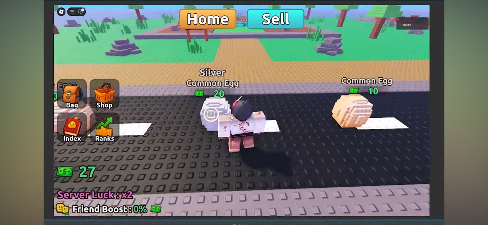

# Slime Eggs – jeu Roblox complet (Luau)

> Un jeu Roblox jouable, dans le style cartoon low poly de la capture de référence : on frappe des
> **slimes** avec une **épée** pour gagner de l'argent, on achète des **œufs** sur un **tapis
> roulant**, on les équipe comme **compagnons** (ils ajoutent du DPS), on achète des **épées** plus
> fortes et des **effets d'attaque**, et on progresse à travers **six zones** jusqu'au **Boss Slime**.



Tout le décor, les modèles 3D et l'interface sont **générés par script** : aucun asset externe
n'est obligatoire, aucun identifiant d'asset n'est inventé. Les images (icônes) et les modèles
3D fournis dans `assets/` sont **facultatifs** et se branchent sans modifier le code.

---

## Sommaire

1. [Le jeu en deux minutes](#1-le-jeu-en-deux-minutes)
2. [Installation dans Roblox Studio](#2-installation-dans-roblox-studio)
3. [Contenu du dépôt, fichier par fichier](#3-contenu-du-dépôt-fichier-par-fichier)
4. [Comment ça marche : les systèmes](#4-comment-ça-marche--les-systèmes)
5. [Régler et équilibrer le jeu](#5-régler-et-équilibrer-le-jeu)
6. [Apparence : icônes, arbres, slimes, œufs](#6-apparence--icônes-arbres-slimes-œufs)
7. [Tester étape par étape](#7-tester-étape-par-étape)
8. [Modifier le code sans rien casser](#8-modifier-le-code-sans-rien-casser)
9. [Dépannage](#9-dépannage)
10. [Choix visuels en attente et idées de suite](#10-choix-visuels-en-attente-et-idées-de-suite)

---

## 1. Le jeu en deux minutes

**Boucle de jeu** : frapper → gagner de l'argent → acheter → équiper → frapper plus fort.

1. Le joueur apparaît sur la place orange avec une **épée en bois** (gratuite) dans la main.
2. Devant lui, un **tapis roulant** noir aux bordures grises : des œufs y apparaissent à gauche,
   avancent, et disparaissent à droite s'ils ne sont pas achetés. Au-dessus de chaque œuf :
   son nom, sa rareté et son prix en vert.
3. Il suit le chemin beige jusqu'à la **Zone 1 – Slime faible** et frappe (clic gauche sur PC,
   bouton **ATTAQUE** sur mobile). Le slime flashe, sa barre de vie baisse, il meurt, le joueur
   gagne 3 $ (« +3 $ » vert à l'écran), le slime réapparaît quelques secondes plus tard.
4. Avec 10 $, il s'approche d'un **Œuf Commun** sur le tapis et appuie sur **E** (ou le bouton
   tactile). L'œuf rejoint son inventaire et, s'il reste une place, **flotte derrière lui** comme
   compagnon.
5. En combat, chaque œuf équipé **attaque automatiquement** le slime visé : plus d'œufs, plus
   rares, plus puissants = plus de DPS = slimes tués plus vite.
6. Boutique : 6 **épées** de plus en plus fortes (plus le DPS total monte, plus les coups sont
   rapides et spectaculaires) et 6 **effets d'attaque** cosmétiques (feu, glace, éclairs, ombres,
   lumière, arc-en-ciel).
7. Six zones de plus en plus loin : slime faible → basique → difficile → très difficile →
   méga difficile → **Boss Slime**. Chaque catégorie a son apparence, ses points de vie et sa
   récompense. Les **rangs** (selon l'argent total gagné) débloquent plus de places d'œufs.
8. Tout est **sauvegardé** (argent, œufs, équipement, épées, effets, rang, index).

**Interface** (comme la capture) : boutons **Home** (orange) et **Sell** (turquoise) en haut ;
**Bag**, **Shop**, **Index**, **Ranks** à gauche ; argent avec billet vert en bas à gauche ;
DPS et rang juste dessous ; bouton rond **ATTAQUE** sur mobile.

| Bouton | Ce qu'il fait |
| --- | --- |
| Home | Téléporte au point de départ (vérifié par le serveur). |
| Sell | Revendre des œufs (50 % du prix) avec confirmation Oui/Non, ou tous les non-équipés d'un coup. |
| Bag | Inventaire : onglet Œufs (équiper / retirer, « Équiper les meilleurs ») et onglet Effets. |
| Shop | Boutique : onglet Épées et onglet Effets (aperçu, achat, équipement). |
| Index | Collection : les 18 combinaisons rareté × variante découvertes ou « ??? ». |
| Ranks | Les 6 paliers de progression, le rang actuel et ce qu'il débloque. |

---

## 2. Installation dans Roblox Studio

### Méthode A – trois fichiers à importer (5 minutes, recommandée)

1. Ouvre Roblox Studio → **New** → modèle **Baseplate**.
2. Récupère les trois fichiers du dossier [`build/`](build/) du dépôt :
   `ReplicatedStorage.rbxmx`, `ServerScriptService.rbxmx`, `StarterPlayerScripts.rbxmx`.
3. Dans la fenêtre **Explorer** de Studio (*View → Explorer* si elle est cachée) :

   | Clic droit sur… | *Insert from File…* | Ce qui apparaît |
   | --- | --- | --- |
   | `ReplicatedStorage` | `ReplicatedStorage.rbxmx` | dossiers `Config` et `Shared` |
   | `ServerScriptService` | `ServerScriptService.rbxmx` | `Main` + dossiers `Services`, `Builders` |
   | `StarterPlayer` → `StarterPlayerScripts` | `StarterPlayerScripts.rbxmx` | `ClientMain` + dossier `Controllers` |

   Si Studio insère les objets dans `Workspace`, fais-les glisser au bon endroit.
4. **Home → Game Settings → Security → Enable Studio Access to API Services** → coché → Save.
   Sans cela, la sauvegarde ne fonctionne pas en test (le jeu tourne quand même, avec un
   avertissement rouge à l'écran).
5. **Play** (F5). Dans *Output* (View → Output) tu dois lire `[SlimeEggs] Serveur prêt ✔` puis
   `[SlimeEggs] Client prêt ✔`, sans ligne rouge.

La `Baseplate` et le `SpawnLocation` du modèle de départ sont supprimés automatiquement par
le script `MapBuilder`, qui génère la map du jeu à la place.

### Méthode B – copier-coller chaque script à la main

L'arborescence exacte, le type de chaque objet (Script / LocalScript / ModuleScript) et la
correspondance avec les fichiers de `src/` sont dans [`docs/00-installation.md`](docs/00-installation.md).
Règle : `Nom.server.lua` → **Script**, `Nom.client.lua` → **LocalScript**, `Nom.lua` → **ModuleScript**,
dossier → **Folder**. Les noms doivent être exacts : le code les utilise avec `require`.

### Méthode C – Rojo (pour synchroniser depuis VS Code)

`default.project.json` est fourni. Avec [Rojo](https://rojo.space) : `rojo serve` dans le dossier
du dépôt, puis *Connect* dans le plugin Rojo de Studio. `rojo build -o SlimeEggs.rbxlx` construit
un lieu complet.

### Tester sur mobile et à plusieurs

- **Mobile** : onglet *Test* → *Device* → choisir un téléphone. Le bouton **ATTAQUE** apparaît,
  les prompts du tapis affichent un bouton tactile, l'interface se met à l'échelle.
- **Multijoueur** : onglet *Test* → *Clients and Servers* → 2 joueurs → *Start*.

---

## 3. Contenu du dépôt, fichier par fichier

```
.
├── README.md                     ← ce fichier
├── CLAUDE.md                     ← contexte pour une session Claude Code (règles, choix en attente)
├── default.project.json          ← projet Rojo
├── build/                        ← les 3 fichiers .rbxmx à importer (générés depuis src/)
├── tools/build_rbxmx.py          ← regénère build/ : python3 tools/build_rbxmx.py
├── assets/
│   ├── icons/                    ← 18 icônes PNG dessinées pour l'interface (+ _planche.png)
│   └── models/                   ← modèles 3D fournis (arbres, œuf) avec leurs README et licences
├── docs/                         ← guides détaillés (installation, architecture, tests, équilibrage…)
└── src/                          ← LE CODE, organisé comme l'Explorateur de Studio
    ├── ReplicatedStorage/
    │   ├── Config/               ← tous les réglages (6 + 2 modules), rien d'autre à modifier pour équilibrer
    │   └── Shared/               ← code partagé client + serveur
    ├── ServerScriptService/
    │   ├── Main.server.lua       ← démarrage du serveur
    │   ├── Services/             ← la logique du jeu (9 modules)
    │   └── Builders/             ← construction 3D (map, slimes, épées)
    └── StarterPlayer/StarterPlayerScripts/
        ├── ClientMain.client.lua ← démarrage du client
        └── Controllers/          ← interface, combat, animations (9 modules)
```

### Configuration (`src/ReplicatedStorage/Config/`)

| Fichier | Ce qu'il règle |
| --- | --- |
| `GameConfig.lua` | argent de départ, point de spawn, tapis (longueur, vitesse, intervalle, distance d'achat), combat (portée des œufs, tolérances réseau), vente (50 %), compagnons (positions, flottement), sauvegarde (nom du DataStore, autosave). |
| `EggConfig.lua` | les 6 raretés (prix, poids d'apparition, DPS, intervalle d'attaque, couleurs, matériau, taches, lumière, particules, aura), les 3 variantes (Normal, Argent, Or), le style 3D (`Style`), les ornements (`Ornaments`). |
| `SlimeConfig.lua` | les 6 catégories (PV, récompense, taille, couleur, nombre, réapparition, zone) et leur apparence détaillée (`Looks` : yeux, cornes, cristaux, pointes, fissures, armure, couronne, particules…). |
| `SwordConfig.lua` | les 6 épées (prix, DPS, portée, style visuel). |
| `EffectConfig.lua` | les 6 effets cosmétiques (prix, couleurs de traînée, impact, lumière, particules). |
| `RankConfig.lua` | les 6 rangs (seuil d'argent total gagné, nombre d'œufs équipables). |
| `IconConfig.lua` | identifiants des images d'interface (vides = emoji de secours). |
| `MapConfig.lua` | sol, styles d'arbres, tronc, quantités de décor, barrière, nuages. |

### Code partagé (`src/ReplicatedStorage/Shared/`)

| Fichier | Rôle |
| --- | --- |
| `Remotes.lua` | crée (serveur) et retrouve (client) les RemoteEvents / RemoteFunction dans `ReplicatedStorage.Remotes`. |
| `CombatMath.lua` | **le cœur de l'équilibrage** : DPS total, paliers de cadence, dégâts par coup = DPS × intervalle, attaques des œufs. |
| `EggBuilder.lua` | construit un œuf 3D (styles Smooth / TwoTone / Faceted / Blocks, ornements, mesh externe) et son étiquette de prix. |
| `Util.lua` | formatage des nombres (« 12 345 », « 1.2k »), copies de tables, réconciliation de sauvegarde. |

### Serveur (`src/ServerScriptService/`)

| Fichier | Rôle |
| --- | --- |
| `Main.server.lua` | crée les remotes et les dossiers `Workspace.ConveyorEggs / Slimes / Companions`, génère la map, démarre les services dans l'ordre. |
| `Services/DataService.lua` | chargement / sauvegarde DataStore avec réessais ; si le chargement échoue, profil vide **sans** sauvegarde (jamais d'écrasement) ; autosave, sauvegarde à la déconnexion et à la fermeture. |
| `Services/RequestRouter.lua` | une seule RemoteFunction `Request(action, payload)` ; chaque service y enregistre ses actions ; anti-spam ; erreurs capturées. |
| `Services/PlayerService.lua` | arrivée / départ, leaderstats, envoi du profil au client (`Push`), `AddCash` / `SpendCash`, rangs, actions `GetProfile` et `GoHome`. |
| `Services/ConveyorService.lua` | fait apparaître / disparaître les œufs, pose le ProximityPrompt, vérifie l'achat (œuf non déjà vendu, distance, argent). |
| `Services/InventoryService.lua` | `AddEgg`, `EquipEgg`, `UnequipEgg`, `EquipBest`, `SellEgg`, `SellUnequipped` ; limite d'équipement selon le rang. |
| `Services/ShopService.lua` | `BuySword`, `EquipSword`, `BuyEffect`, `EquipEffect`. |
| `Services/CompanionService.lua` | crée les modèles 3D des œufs équipés dans `Workspace.Companions.<Joueur>`. |
| `Services/SlimeService.lua` | apparition dans les zones, sauts, points de vie, mort, **récompenses réparties au prorata des dégâts**, réapparition. |
| `Services/CombatService.lua` | reçoit `Attack`, vérifie cadence / portée / cible, applique les dégâts, fait attaquer les œufs équipés pendant le combat. |
| `Builders/MapBuilder.lua` | sol, chemins, zones + panneaux, arbres (5 styles), rochers, buissons, fleurs, barrière + murs invisibles, nuages, tapis, spawn, lumière. |
| `Builders/SlimeBuilder.lua` | modèle 3D d'un slime d'après sa catégorie et son `Look`, barre de vie. |
| `Builders/SwordBuilder.lua` | épée soudée à la main droite (R15 et R6), traînée lumineuse. |

### Client (`src/StarterPlayer/StarterPlayerScripts/`)

| Fichier | Rôle |
| --- | --- |
| `ClientMain.client.lua` | démarre tous les contrôleurs. |
| `Controllers/ClientState.lua` | copie locale du profil, `Request(action, payload)`, notifications de changement. |
| `Controllers/UIController.lua` | **toute l'interface** par script : HUD, panneaux (Bag, Shop, Sell, Index, Ranks), confirmations, toasts, bouton ATTAQUE, mise à l'échelle PC / mobile. |
| `Controllers/CombatController.lua` | clic / bouton tactile → slime le plus proche à portée → animation → `Attack:FireServer`. Anime aussi les coups des autres joueurs. |
| `Controllers/CombatVFX.lua` | animation du bras (Motor6D), traînée, impacts (particules + lumière), nombres de dégâts, aperçu d'effet. Plus intense à chaque palier de DPS. |
| `Controllers/ConveyorController.lua` | position des œufs du tapis d'après l'heure serveur (fluide et identique pour tous), lamelles du tapis. |
| `Controllers/CompanionController.lua` | suivi fluide + flottement des œufs de tous les joueurs, charge visuelle lors d'une attaque. |
| `Controllers/EggAnimator.lua` | fait tourner les éclats en orbite autour des œufs. |
| `Controllers/SlimeAnimator.lua` | respiration, clignement, flash + compression au coup, rétrécissement à la mort. |
| `Controllers/DecorController.lua` | dérive des nuages. |

---

## 4. Comment ça marche : les systèmes

### Principe de sécurité : le serveur décide de tout

Le client n'envoie que des **intentions** : « je frappe ce slime », « j'achète cette épée ».
Le serveur vérifie l'argent, la possession, la distance, la cadence, la portée, puis applique.
Le client ne choisit jamais les dégâts ni l'argent gagné. Deux canaux seulement :

- `RemoteFunction Request(action, payload)` → réponse `{ ok, message, data }` pour tout ce qui
  touche à l'inventaire, la boutique, la vente, Home.
- `RemoteEvent Attack(slime)` pour les coups d'épée (pas de réponse : le serveur renvoie
  `AttackVFX` à tout le monde si le coup est validé).

Le serveur pousse le profil complet au client (`ProfileUpdated`) après chaque changement ;
l'interface se redessine à partir de cette copie.

### Achat d'un œuf sur le tapis

```
ProximityPrompt déclenché
 → ConveyorService.tryBuy : l'œuf passe immédiatement "Sold = true" (premier arrivé)
 → vérifications : profil chargé, personnage présent, distance recalculée d'après l'heure
   d'apparition, argent suffisant (sinon : "Sold = false" + message)
 → SpendCash → InventoryService.AddEgg (équipe automatiquement s'il reste une place)
 → CompanionService.Refresh (le compagnon apparaît) → PlayerService.Push (interface à jour)
```

Deux joueurs qui appuient en même temps : un seul l'obtient, l'autre lit « Trop tard, cet œuf
vient d'être acheté ! ».

### Coup d'épée

```
Clic / bouton → CombatController choisit le slime vivant le plus proche à portée
 → animation locale immédiate (bras, traînée) → Attack:FireServer(slime)
 → CombatService.onAttack : cadence (intervalle du palier × tolérance 0.75), portée
   (portée de l'épée + taille du slime + tolérance), cible vivante
 → SlimeService.ApplyDamage (dégâts calculés par le serveur avec CombatMath)
 → AttackVFX:FireAllClients → impact + nombre de dégâts chez tout le monde,
   animation du bras chez les autres joueurs
 → si PV ≤ 0 : récompenses, animation de mort (client), réapparition après RespawnTime
```

### DPS, paliers et dégâts par coup

Tout part du **DPS** pour ne jamais multiplier la puissance deux fois :

- DPS total = DPS de l'épée + somme des DPS des œufs équipés.
- Le DPS total donne un **palier** (Novice → Mythique) qui fixe l'**intervalle** entre deux coups
  (0.60 s → 0.22 s, vitesse maximale pour rester lisible).
- **Dégâts par coup de l'épée = DPS de l'épée × intervalle.** Monter de palier rend donc les coups
  plus rapides et plus spectaculaires (traînée plus large, enchaînements alternés) sans changer
  le DPS de l'épée.
- Chaque œuf a son propre intervalle (1.2 s pour un Commun, 0.7 s pour un Mythique) :
  dégâts par attaque = DPS de l'œuf × intervalle de sa rareté.

### Œufs compagnons

Tant que le joueur a frappé il y a moins de 8 s, chaque œuf équipé attaque toutes les
`AttackInterval` secondes : le dernier slime frappé s'il est à portée (28 studs), sinon le plus
proche. Le serveur applique les dégâts et prévient les clients (`CompanionAttack`) qui jouent
la petite charge de l'œuf et le nombre de dégâts. Les œufs n'attaquent jamais toute la map.

Le mouvement des compagnons est calculé par **chaque client** (position derrière le joueur,
interpolation, flottement) : aucun trafic réseau pour le suivi.

### Slimes

Le serveur fait sauter les slimes vers un point aléatoire de leur zone et gère PV / mort /
réapparition. Les animations (respiration, clignement, flash du coup, mort) sont jouées par le
client `SlimeAnimator` en lisant les attributs `Health` et `Alive` du modèle.

À la mort, la récompense est **répartie au prorata des dégâts** de chaque participant (minimum
1 $), une seule fois (drapeau `Alive`). Elle compte pour le rang ; les ventes d'œufs non.

### Sauvegarde

Profil stocké dans le DataStore `SlimeEggs_v1` (clé `player_<UserId>`) :

```lua
{
  Cash = 0, TotalEarned = 0, Kills = 0,
  Eggs = { { Id = "e1", Rarity = "Common", Variant = "Normal" } }, NextEggId = 2,
  Equipped = { "e1" },
  Swords = { "Wood" }, EquippedSword = "Wood",
  Effects = {}, EquippedEffect = "",
  Discovered = { Common_Normal = true },
}
```

Chargement avec 3 essais ; en cas d'échec le joueur joue avec un profil vide mais **la
sauvegarde est désactivée** pour la session (message rouge), afin de ne jamais écraser une
vraie sauvegarde. Sauvegarde toutes les 2 minutes, à la déconnexion et à la fermeture du serveur.
Les vieilles sauvegardes reçoivent automatiquement les champs manquants.

---

## 5. Régler et équilibrer le jeu

Tous les nombres sont dans `src/ReplicatedStorage/Config/`. Détails et tableaux complets dans
[`docs/03-equilibrage.md`](docs/03-equilibrage.md). Résumé :

| Rareté d'œuf | Prix | Chance | DPS | Slime | PV | Récompense | Épée | Prix | DPS |
| --- | --- | --- | --- | --- | --- | --- | --- | --- | --- |
| Commun | 10 | 50 % | 1 | Faible | 20 | 3 | Bois | 0 | 5 |
| Peu commun | 50 | 28 % | 3 | Basique | 100 | 12 | Fer | 75 | 15 |
| Rare | 250 | 13 % | 10 | Difficile | 600 | 60 | Acier | 600 | 45 |
| Épique | 1 500 | 6 % | 35 | Très difficile | 4 000 | 350 | Cristal | 4 500 | 150 |
| Légendaire | 10 000 | 2.5 % | 120 | Méga difficile | 30 000 | 2 200 | Dragon | 35 000 | 500 |
| Mythique | 75 000 | 0.5 % | 450 | Boss | 250 000 | 15 000 | Mythique | 280 000 | 1 800 |

Variantes d'œufs : Argent (12 %, prix ×2, DPS ×1.5), Or (3 %, prix ×4, DPS ×2.5).
Effets : 500 → 150 000 $, purement cosmétiques. Rangs : 0 / 500 / 5 000 / 50 000 / 500 000 /
5 000 000 $ gagnés en combat → 3, 3, 4, 4, 5, 6 œufs équipables.

Exemples de modifications courantes :

- Rendre le début plus rapide : baisse `Health` du slime `Weak` ou monte `DPS` de l'épée `Wood`.
- Plus d'œufs rares : augmente leur `Weight` dans `EggConfig` (les poids sont relatifs).
- Une septième épée : ajoute une entrée dans `SwordConfig.List`, c'est tout (boutique, sauvegarde
  et modèle 3D suivent).
- Remettre toutes les sauvegardes à zéro : change `GameConfig.Data.StoreName`.

---

## 6. Apparence : icônes, arbres, slimes, œufs

### Icônes de l'interface (`assets/icons/`)

18 icônes PNG dessinées (sac, caddie, livre, graphique, maison, pièces, billet, épée, œuf,
épées croisées, feu, glace, éclair, ombre, lumière, arc-en-ciel, étoile, fermer). Tant qu'elles
ne sont pas uploadées, l'interface affiche des emoji. Pour les activer : *View → Asset Manager →
Bulk Import* des PNG, puis coller chaque identifiant (`rbxassetid://…`) dans `IconConfig.lua`.

### Décor (`MapConfig.lua`)

- Sol lisse vert (pas d'herbe), chemins beiges, zones colorées avec panneau (nom, PV, récompense).
- Arbres : styles `"A"` boules étagées, `"B"` low poly facetté, `"C"` sapin, `"D"` parasol,
  `"E"` palmier ; mélange libre dans `TreeStyles`. Tronc `"Smooth"`, `"Bark"` ou `"Twisted"`.
  Variations automatiques (forme, nombre de boules / cubes, palettes verts, citron, automne, cerisier).
- Rochers moussus, buissons, fleurs ; barrière low poly tout autour (+ murs invisibles) ;
  nuages qui dérivent.
- Modèles d'arbres importés : dépose-les dans `ReplicatedStorage > Assets > TreeModels`
  (trois arbres low poly sont fournis dans `assets/models/trees/`).

### Slimes (`SlimeConfig.Looks`)

Bien plus que la taille et la couleur : joues roses (faible), pousse et taches (basique),
sourcils en colère + crocs + cristaux de glace + givre (difficile), trois yeux + cornes + fumée
d'ombre + aura (très difficile), pointes + fissures de lave + flammes + yeux lumineux (méga),
quatre yeux + armure dorée + couronne + braises + aura rouge (Boss).

### Œufs (`EggConfig`)

- `Style` : `"Smooth"` lisse, `"TwoTone"` deux tons + anneau, `"Faceted"` gemme, `"Blocks"`
  blocs comme la photo.
- `Ornaments` par rareté : pousse, éclats de cristal, anneaux métalliques, fissures lumineuses,
  éclats en orbite animés. Plus lumière, particules et aura selon la rareté.
- Mesh importé : dépose un MeshPart nommé comme la rareté dans `ReplicatedStorage > Assets >
  EggMeshes` (un œuf low poly est fourni dans `assets/models/eggs/`).

Où trouver d'autres modèles (Creator Store, poly.pizza, kenney.nl, quaternius.com, sketchfab),
quoi chercher et comment importer : [`docs/05-assets-externes.md`](docs/05-assets-externes.md).

---

## 7. Tester étape par étape

Le détail avec les résultats attendus est dans [`docs/02-etapes-et-tests.md`](docs/02-etapes-et-tests.md).

1. **Version minimale** : map générée, œufs qui défilent, épée en main, un slime qui meurt,
   « +3 $ », achat d'un œuf avec E, compagnon qui suit, œuf qui attaque, Bag qui équipe / retire.
2. **Boutique d'épées et paliers** : achat de l'épée en fer, coups plus rapides, DPS affiché.
3. **Effets** : aperçu, achat, traînée et impact colorés, retrait, conservation après reconnexion.
4. **Inventaire, vente, index, rangs** : limite de 3, « Équiper les meilleurs », vente avec
   confirmation, Index qui se remplit, rang qui monte à 500 $.
5. **Zones, boss, multijoueur** : récompense partagée, achat simultané refusé pour le second.
6. **Sauvegarde** : quitter / revenir, message si API Services désactivés.

---

## 8. Modifier le code sans rien casser

1. Modifie les fichiers dans `src/` (ou directement dans Studio, puis recopie dans `src/`).
2. Vérifie la syntaxe sans Studio : `stylua --check <fichier>` (StyLua lit le Luau).
3. Regénère les fichiers d'import : `python3 tools/build_rbxmx.py` → `build/`.
4. Réimporte dans Studio (ou laisse Rojo synchroniser) et rejoue les tests de la section 7.

Conventions : réglages uniquement dans `Config/` ; textes du jeu en français ; noms des boutons
du HUD en anglais comme la capture ; jamais de calcul de dégâts ou d'argent côté client ;
animations de décor côté client. `CLAUDE.md` résume ces règles pour une session Claude Code.

---

## 9. Dépannage

| Symptôme | Cause probable | Solution |
| --- | --- | --- |
| `Dossier Remotes introuvable` | `Main` n'a pas démarré (ce doit être un **Script**). | Vérifie `ServerScriptService.Main` et son type. |
| `… is not a valid member of Folder "Config"` | Un ModuleScript manque ou est mal nommé. | Compare avec l'arborescence de `docs/00-installation.md`. |
| Rien à l'écran | `ClientMain` n'est pas un **LocalScript** ou `Controllers` est mal placé. | `StarterPlayer > StarterPlayerScripts > ClientMain` + dossier `Controllers`. |
| Message rouge « Données non chargées » | API Services désactivés. | Game Settings → Security → Enable Studio Access to API Services. |
| L'épée n'apparaît pas | Chargement du personnage trop rapide, ou rig inhabituel. | Relance ; le code gère R15 et R6. |
| Le bras tourne à l'envers | Rig personnalisé. | Dans `CombatVFX.armRotation`, inverse le signe de `angle`. |
| Les œufs du tapis ne bougent pas | `Map.Conveyor.Slats` absent ou client en erreur. | Lis l'Output côté client ; la map doit être générée par `MapBuilder`. |
| Un emoji s'affiche en carré | Police sans cet emoji. | Uploade les icônes (`IconConfig`) ou remplace l'emoji par du texte. |
| Rien ne se passe en cliquant un slime | Trop loin. | Approche-toi : le serveur rejette les coups hors portée. |

Plus de cas dans [`docs/04-depannage.md`](docs/04-depannage.md).

---

## 10. Choix visuels en attente et idées de suite

**À choisir par le propriétaire du jeu** (des rendus 3D lettrés ont été fournis) :

- Tronc d'arbre : **T1** lisse effilé, **T2** écorce striée + nœud + racines (actuel), **T3** tordu.
  → `MapConfig.TrunkStyle = "Smooth" | "Bark" | "Twisted"`.
- Style d'œuf généré : **A** lisse (actuel), **B** deux tons, **C** facetté, **D** blocs.
  → `EggConfig.Style = "Smooth" | "TwoTone" | "Faceted" | "Blocks"`.
- Arbres : A et B retenus (`MapConfig.TreeStyles = { "A", "B" }`).

**Idées de suite** (non faites, à demander) : tutoriel guidé pour les nouveaux joueurs, codes
promo, quêtes journalières, zones supplémentaires, boutique Robux (passes), classement global,
sons et musique (nécessitent des assets audio uploadés), terrain avec reliefs si souhaité.

---

## Licences

Code et documentation du dépôt : libres d'utilisation pour ce jeu. Modèles 3D fournis dans
`assets/models/` : voir les `README.md` de chaque dossier (CC0 ou CC-BY, auteur à citer dans la
description du jeu pour CC-BY). Icônes de `assets/icons/` : dessinées pour ce projet.
